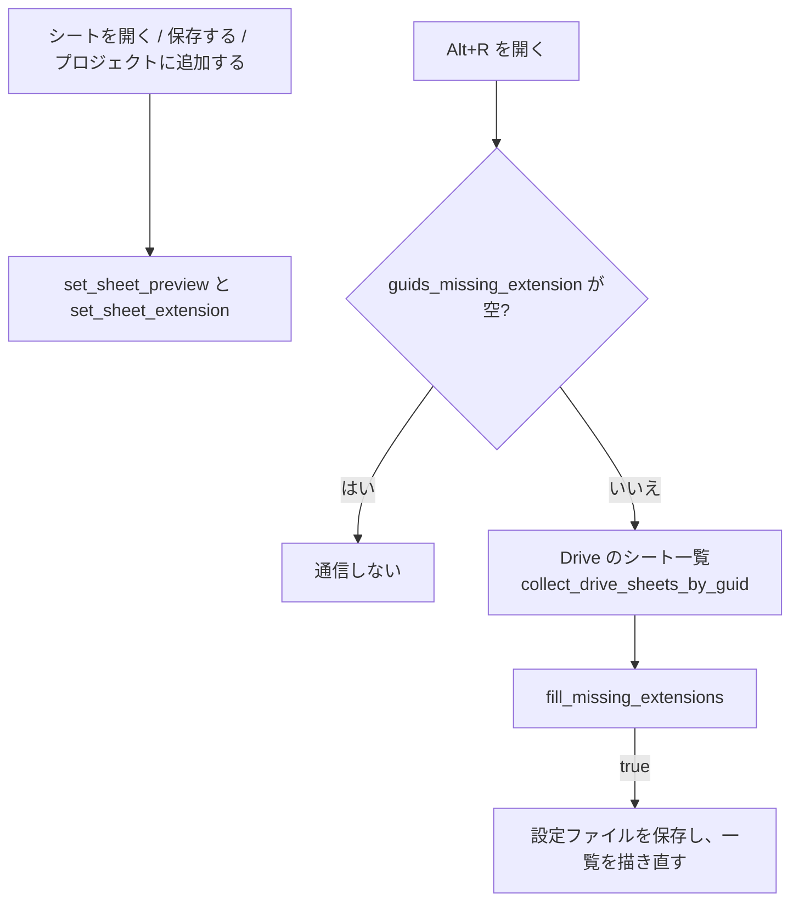

# プレビュー（サムネイル）の描画改善 仕様

- 状態: **実装済み（2026-11-01）**。テスト 126 件は緑。実機での動作確認待ち（§7）
- 関連: docs/PROJECT_SHEET_ON_DEMAND_SPEC.md（Alt+R の一覧）

## 1. 背景

Alt+R（プロジェクトのシート一覧）のカードが、シートの種類に応じて描画されないことが多い。

| 原因 | 内容 |
|---|---|
| 拡張子が分からない | 未オープンのシートは設定ファイル（`ProjectStore`）の `previews` しか持っておらず、カードの見出しに guid を使っている。拡張子が無いので常に「テキスト」として描画され、Markdown の見出しや表、コードの色分けにならない |
| 中身が短い | `previews` は先頭 **5 行**。カードの大きさに対して中身が少ない |

あわせて、プレビューの末尾が途中で切れて見えるので、最後の 2 行をフェードアウトさせる。

## 2. 変更点の一覧

| # | 変更 | 対象 |
|---|---|---|
| A | `previews` を先頭 5 行 → **20 行**にする | `preview_from_content` |
| B | シートごとの**拡張子**を設定ファイルに保存し、未オープンのカードも拡張子に応じて描画する | `ProjectStore.extensions`（新規）、`build_switcher_items` |
| C | プレビュー表示の**最後の 2 行**を、不透明度 1.0 → 0.0 のグラデーションで消す | CSS（§5） |

## 3. A: プレビューを 20 行にする

- `preview_from_content` の `MAX_LINES` を 5 → 20 に変える。1 行 80 文字で打ち切る規則はそのまま
- 既存の 5 行のプレビューは、シートを開く・保存する・プロジェクトに追加する時に 20 行で上書きされる（`set_sheet_preview` は内容が変われば更新する）
- 設定ファイルの大きさ: 1 シートあたり最大 20 行 × 80 文字。日本語（UTF-8 で 3 バイト）なら最大で約 4.8KB、100 シートで約 480KB

## 4. B: 拡張子を保存して、未オープンのカードも描画する

### 4.1 設定ファイル

```rust
pub struct ProjectStore {
    pub version: u32,
    pub projects: Vec<Project>,
    pub previews: BTreeMap<String, String>,
    /// guid → 拡張子（小文字、ドット無し。例: "md"）
    #[serde(default)]
    pub extensions: BTreeMap<String, String>,
}
```

- `#[serde(default)]` なので、古い設定ファイル（`extensions` 無し）もそのまま読める。`version` は上げない
- 拡張子はシートの表示名（Drive のファイル名 `{guid}.{拡張子}`）から取る

### 4.2 関数

| 関数 | 規則 |
|---|---|
| `extension_from_name(name) -> Option<String>` | `abc.MD` → `Some("md")`。拡張子が無い（`abc`）、末尾がドット（`abc.`）、先頭がドットだけ（`.env`）の場合は `None` |
| `set_sheet_extension(guid, name) -> bool` | 拡張子を記録する。拡張子が取れない場合と、既に同じ値の場合は `false`（無駄な保存をしない） |
| `guids_missing_extension() -> Vec<String>` | いずれかのプロジェクトに所属していて、拡張子が未記録の guid（登録順、重複無し） |
| `fill_missing_extensions(names: &BTreeMap<guid, 名前>) -> bool` | 未記録の guid だけ `names` から補う。記録済みは上書きしない。1 件でも補えたら `true` |
| `prune_missing_sheets`（既存） | どのプロジェクトからも参照されなくなった guid の拡張子も `previews` と同様に捨てる |

### 4.3 記録するタイミング



- 既存のシートは記録が無いので、Alt+R を開いた時に**足りない分がある場合だけ** Drive の一覧から補う。一度補えば、以降は通信しない

### 4.4 一覧の組み立て

`build_switcher_items` に `extensions` を渡す。

| 未オープンのシート | `title` |
|---|---|
| 拡張子が記録済み | `{guid}.{拡張子}`（例: `abc.md`） |
| 未記録 | `guid`（従来どおり。テキストとして描画） |

`title` から `display_extension` → `DocStyle::from_extension` → `doc_html` を通るので、開いているシートと同じ描画処理（Markdown は Markdown、コードは言語ごとの色分け）になる。

## 5. C: 最後の 2 行をフェードアウトする

### 5.1 対象

| 画面 | 場所 | 今の表示 |
|---|---|---|
| Alt+R | シートのカードの中身 | カードの大きさで切れる（縮小表示） |
| プロジェクトダイアログ（Alt+P） | 所属シートのカード | `line-clamp-5` |
| シート選択ダイアログ | グリッド表示のカード | `line-clamp-5` |
| シート選択ダイアログ | リスト表示の先頭行 | 先頭 12 行を高さで切る |

対象外: プレビュー画面そのもの、タブ選択ダイアログの下半分（全文をスクロールして読む画面のため）。

### 5.2 見た目

```
1 行目  ──────────────── 不透明度 1.0
 …
n-2 行目 ─────────────── 不透明度 1.0
n-1 行目 ─────────────── 1.0 → 0.5（グラデーション）
n 行目  ──────────────── 0.5 → 0.0
```

- CSS の `mask-image: linear-gradient(to bottom, #000 calc(100% - 2行分), transparent 100%)` を、表示枠に掛ける
- 2 行分の高さは各表示の行の高さから決める（`.leaf-fade-tail` に変数 `--leaf-fade-height` を持たせ、場所ごとに値を変える）
  - プロジェクトダイアログ・シート選択ダイアログ: 行の高さ（`leading-snug` = 1.375em）× 2 = 2.75em
  - Alt+R: カードの中身は 0.2 倍に縮小しているので、縮小後の 2 行分（13px × 1.6 × 0.2 × 2 ≒ 8.3px）
- `line-clamp-5` は**行数で高さが決まる**ため、本文が 2 行しかないとその 2 行が薄くなってしまう。そこで表示枠の高さを **5 行分に固定**（`height: calc(1.375em * 5)` + `overflow: hidden`）し、`line-clamp-5` は外す。本文が短ければ下端に文字が届かず、薄くならない
- Alt+R の選択中のカードはスクロールできる。フェードは表示枠に掛かるので、末尾までスクロールしても最後の 2 行は薄いまま（§7 で確認）

## 6. テスト（先に追加済み）

`src/project.rs`

| テスト | 内容 |
|---|---|
| `preview_keeps_only_first_twenty_lines` | 25 行の本文から先頭 20 行だけ残る（従来の 5 行のテストを置き換え） |
| `extension_is_taken_from_name_in_lower_case` | `abc.MD` → `md`、`a.b.rs` → `rs` |
| `name_without_extension_has_no_extension` | `abc` / `abc.` / `.env` / 空 → `None` |
| `set_sheet_extension_reports_changes_only` | 初回 `true`、同じ値 `false`、拡張子無しは記録しない |
| `guids_missing_extension_lists_unrecorded_project_sheets` | 記録済み・重複・所属外を除き、登録順で返す |
| `fill_missing_extensions_does_not_overwrite_recorded` | 未記録だけ補い、記録済みは保つ。補えなければ `false` |
| `prune_drops_extensions_no_longer_referenced` | 所属から外れた guid の拡張子を捨てる |
| `store_without_extensions_field_still_loads` | 古い設定ファイルが読め、`extensions` は空 |

`src/components/project_sheet_switcher.rs`

| テスト | 内容 |
|---|---|
| `closed_sheet_title_carries_recorded_extension` | 拡張子が記録済みなら `title` が `guid.md` になり、`display_extension` が `MD` |
| `closed_sheet_without_extension_keeps_guid_title` | 未記録なら従来どおり `guid` |

フェード（§5）は見た目だけの変更のため、単体テストではなく §7 で確認する。

## 7. 動作確認項目（実装後）

- [ ] Alt+R: 未オープンの Markdown シートが見出し・リスト付きで、コードのシートが色分けされて表示される
- [ ] Alt+R: 既存のシート（拡張子が未記録）を初めて開いた時に補われ、2 回目以降は通信しない
- [ ] 各画面のプレビューで最後の 2 行が消えていく
- [ ] 2〜3 行しかないシートのカードは薄くならない
- [ ] Web 版・デスクトップ版（macOS / Windows / Linux の WebView）
