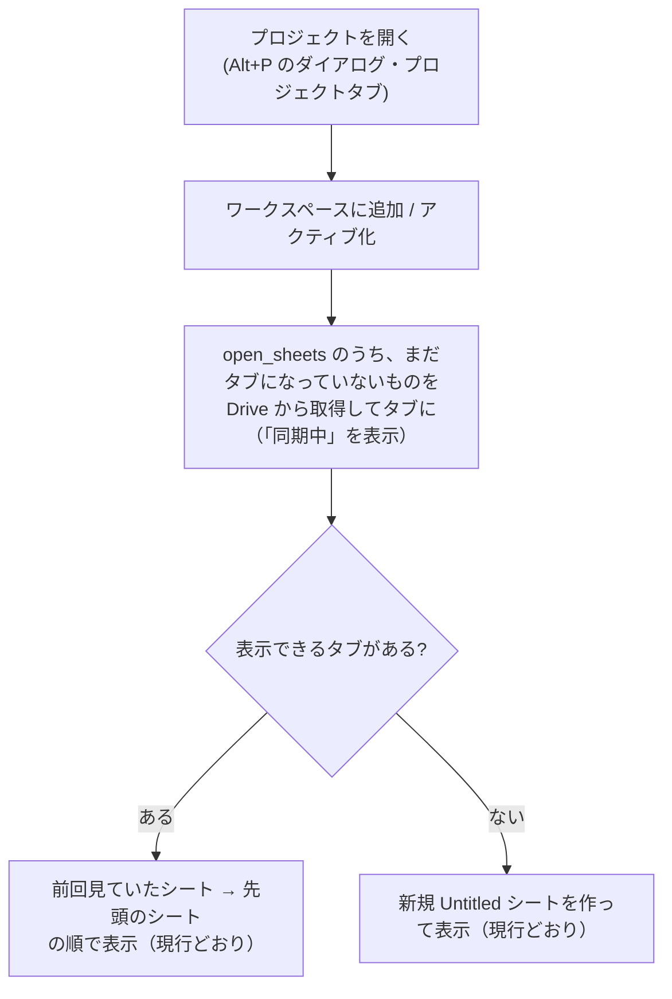
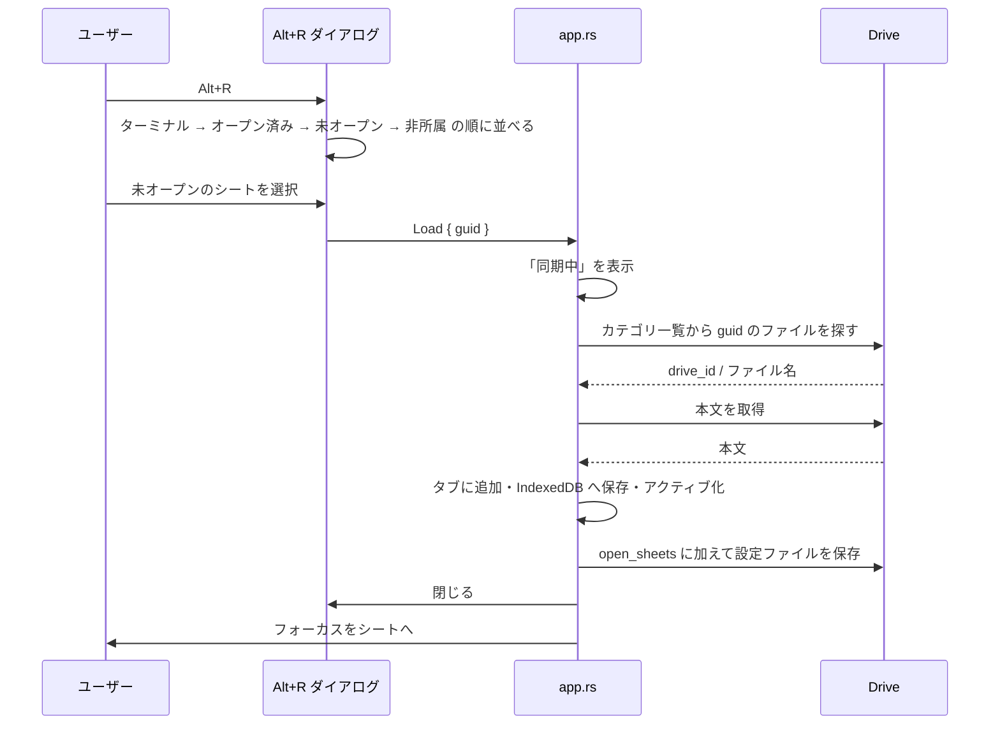

# プロジェクトのシートを選択したものだけ開く仕様

- 対象バージョン: v0.30.4 以降
- 関連仕様: `docs/PROJECT_FEATURE_SPEC.md`、`docs/PROJECT_WORKSPACE_SPEC.md`
- 状態: **実装済み（2026-09-17）**。テスト 20 件は緑。実機での動作確認待ち（§7）

## 1. 背景と目的

現行では、プロジェクトを開くと**所属シートを全て Drive から読み込んでタブにする**。
所属シートが多いと開くのが遅く、使わないシートまでタブに並んでしまう。

新仕様では、シートは **Alt+R で選んだ時だけ**開く。どのシートを開いているかは
**プロジェクトの設定として保持**し、プロジェクトを開いた時や起動時の復元では
**開いていたシートだけ**を戻す。

| | 現行 | 新仕様 |
|---|---|---|
| プロジェクトを開く | 所属シートを**全て** Drive から取得 | **開いていたシート（設定に保持）だけ**取得 |
| Alt+R の一覧 | 開いているタブだけ | **所属シート全て**（オープン済み → 未オープンの順） |
| シートを開く契機 | プロジェクトを開いた時に自動 | **Alt+R で選んだ時だけ** |
| 起動時の復元 | 開いていない所属シートを全て取得 | **開いていたシートだけ**取得 |
| どれを開いているか | 保持しない（端末のタブ状態のみ） | **設定ファイルに保持**（端末をまたいで同じ） |

## 2. 用語

| 用語 | 意味 |
|---|---|
| 所属シート | 設定ファイルの `sheets`（guid の配列、登録順）に入っているシート |
| オープン済み | 所属シートのうち、設定ファイルの `open_sheets` に入っているもの。タブとして開く対象 |
| 未オープン | 所属シートのうち `open_sheets` に無いもの |
| プレビュー | 設定ファイルの `previews`（guid → 先頭 5 行）。未オープンのカードの中身に使う |

## 3. 仕様

### 3-1. プロジェクトを開く／切り替える



- 取得対象は `sheets` 全体ではなく **`open_sheets`** に限る。それ以外は現行の処理をそのまま使う
- 既に開いているプロジェクトへの切り替えは読み込みなし（現行どおり）
- **プロジェクトを閉じても `open_sheets` は消さない**。次に開いた時に同じシートが戻る
  （閉じる＝タブを片付けるだけで、「何を開いていたか」は覚えておく）

### 3-2. Alt+R ダイアログ

一覧に並べるもの（この順）:

1. 現在のプロジェクトの**ターミナル**（現行どおり先頭）
2. **オープン済み**の所属シートを登録順で（本文を書類カードに描画）
3. **未オープン**の所属シートを登録順で（プレビューを描画。**タイトルバーの文字をグレー**にする）
4. プロジェクトに属さないが表示中のシート（**未保存の新規シート**、**ローカルシート**）を末尾に

選択時の挙動:

| 選んだもの | 動作 |
|---|---|
| ターミナル / オープン済みシート | 現行どおりタブを切り替える |
| **未オープンのシート** | Drive から読み込んでタブに追加し、アクティブにする。**`open_sheets` に加えて保存**する。読み込み中は「同期中」を表示 |



- 未オープンのカードの**ファイル名（拡張子）は分からない**。設定ファイルは guid とプレビューしか持たないため、
  未オープンのカードはテキスト書類として描画する（拡張子バッジは出さない）
- 同じシートが（取得中に別経路で）開かれていた場合は二重に追加しない（現行の重複除去を流用）

### 3-3. 起動時の復元

- IndexedDB から開いていたタブを戻す（現行どおり）
- 開いているプロジェクトの一覧とアクティブなプロジェクトを戻す（現行どおり）
- 開いている各プロジェクトについて、**`open_sheets` のうちまだタブになっていないもの**を Drive から取得する
  （現行は `sheets` 全体が対象。対象を絞るだけで、「プロジェクト復元中」の表示・監視・並列取得は現行のまま使う）

### 3-4. 表示できるタブが無い時

現行どおり、**新規 Untitled シートを作って表示する**（レビューで決定）。

### 3-5. Drive 上に存在しないシート

未オープンのシートを選んだが Drive 上に見つからない場合:

- `file_not_found`（既存キー）のメッセージを表示する
- 現行の `prune_missing_sheets` で設定ファイルから取り除き、保存する（`open_sheets` からも外れる）
- ダイアログは閉じ、表示中のシートはそのまま

### 3-6. `open_sheets` が変わるタイミング

| 契機 | 変化 | 保存 |
|---|---|---|
| Alt+R で未オープンを選んで開いた | 追加 | する |
| Alt+M で所属シートを開いた（所属追加と同時） | 追加 | する |
| 新規シートを初めて保存した（所属昇格と同時） | 追加 | する |
| **タブを閉じた**（Alt+W / ×）— 所属シートの場合 | 削除 | する |
| プロジェクトダイアログで所属を外した | 削除 | する |
| Drive に無く `prune_missing_sheets` で外れた | 削除 | する |
| **プロジェクトを閉じた**（ワークスペースから外す） | **変えない** | — |
| ターミナル | 対象外（実行時のみ、現行どおり） | — |

未保存の新規シートは guid が無いため `open_sheets` に入れられない。保存して guid が確定した時に加える。

## 4. 純粋関数の設計（テスト対象）

### 4-1. Alt+R の一覧（`src/components/project_sheet_switcher.rs`）

```rust
pub enum SwitcherItemKind { Terminal, OpenSheet, ClosedSheet }

pub struct SwitcherItem {
    pub kind: SwitcherItemKind,
    /// Terminal / OpenSheet はタブ ID、ClosedSheet は guid
    pub id: String,
    pub title: String,
    /// OpenSheet は本文、ClosedSheet はプレビュー、Terminal は空
    pub content: String,
    pub tab_color: String,
}

pub enum SwitcherSelection {
    /// 既に開いているタブへ切り替える
    Tab(String),
    /// 未オープンのシートを Drive から読み込んで開く
    Load { guid: String },
}

pub fn build_switcher_items(
    terminals: &[(String, String)],       // (タブ ID, 表示名)
    project_sheet_guids: &[String],       // Project.sheets（登録順）
    previews: &BTreeMap<String, String>,  // ProjectStore.previews
    open_sheets: &[OpenSheetInput],       // 現在のプロジェクトのタブ（ローカル含む）
) -> Vec<SwitcherItem>;
```

| # | 規則 |
|---|---|
| 1 | ターミナルを渡された順で先頭に置く |
| 2 | 所属シートは**オープン済みを先に**まとめ、次に未オープン。それぞれの中は登録順。オープン済みはタブ ID と本文、未オープンは guid とプレビュー |
| 3 | guid の突き合わせは `tabs::sheet_project_keys` を使い、`abc` と `abc.md` の表記揺れを吸収する |
| 4 | 同じ guid が二重に登録されていても 1 回だけ出す |
| 5 | 所属シートに一致した開いているシートは、末尾の非所属グループに重ねて出さない |
| 6 | 所属シートに一致しない開いているシート（未保存の新規・ローカル）は末尾に渡された順で置く |
| 7 | プレビューが無い未オープンのシートは本文を空にする |
| 8 | `selection()` は Terminal / OpenSheet → `Tab(id)`、ClosedSheet → `Load { guid }` |

ここでの「オープン済み」はダイアログを組み立てる時点で**タブとして開いているか**で判定する
（設定ファイルの `open_sheets` は app.rs 側で同期されている前提）。

### 4-2. 開いているシートの保持（`src/project.rs`）

```rust
pub struct Project {
    // ...既存...
    /// タブとして開いている所属シートの guid。設定ファイルに保存し、端末をまたいで同じにする
    #[serde(default)]
    pub open_sheets: Vec<String>,
}

impl Project {
    /// 復元で開くべき guid を登録順で返す。所属から外れた guid は無視する
    pub fn open_sheets_to_restore(&self) -> Vec<String>;
}

impl ProjectStore {
    /// 開いている状態を変える。変化があれば Some(true)、無ければ Some(false)、
    /// プロジェクトが無ければ None。open=true は所属シートにしか付けない
    pub fn set_sheet_open(&mut self, project_id: &str, sheet_guid: &str, open: bool, now: u64) -> Option<bool>;
}
```

| # | 規則 |
|---|---|
| 1 | 設定ファイルに `open_sheets` が無ければ空として読む（旧ファイルとの互換） |
| 2 | `set_sheet_open(.., true)` は所属シートにだけ付く。二重には付かない |
| 3 | 所属していない guid に付けようとしても何も変えない |
| 4 | `set_sheet_open(.., false)` で外れる。無いものを外しても変化なし |
| 5 | 変化があった時だけ `updated_at` を更新する |
| 6 | 所属を外す（`toggle_sheet` off / `remove_sheet` / `prune_missing_sheets`）と `open_sheets` からも外れる |
| 7 | `open_sheets_to_restore()` は `sheets` の登録順で返し、所属から外れた guid は含めない |
| 8 | JSON を往復しても `open_sheets` が保たれる |

## 5. 影響範囲

| ファイル | 変更 |
|---|---|
| `src/project.rs` | `Project.open_sheets` を追加。`set_sheet_open` / `open_sheets_to_restore`。所属を外す処理（`toggle_sheet` / `remove_sheet` / `prune_missing_sheets`）で `open_sheets` も整理。`missing_sheets` は「まだタブになっていないもの」の抽出に引き続き使い、`open_sheets_to_restore()` と組み合わせて対象を絞る |
| `src/components/project_sheet_switcher.rs` | `SwitcherItem` / `SwitcherSelection` / `build_switcher_items` を追加。未オープンのカードはタイトルバーの文字をグレーに。`on_select` を `Callback<SwitcherSelection>` へ |
| `src/app.rs` | プロジェクトを開く処理と起動時復元の取得対象を `sheets` → `open_sheets_to_restore()` に変更。Alt+R の `Load` を `on_open_project_sheet_cb` で処理（`collect_drive_sheets_by_guid` + `load_sheet_from_drive` を 1 件に対して使う）。開く経路（Alt+R / Alt+M / 初回保存）は `attach_sheet_to_project` と `on_open_project_sheet_cb` で `set_sheet_open(true)`。タブが閉じられた検出は、描画ごとに「タブとして開いている guid の集合」を控えておき、消えた guid に対して `set_sheet_open(false)` する effect で一元化（閉じる経路が複数あるため）。プロジェクトを閉じる時は先にその集合から外し、閉じた扱いにしない。Drive に無い時の通知は `notice_dialog`（`CustomDialog` の OK 1 択） |
| `docs/PROJECT_WORKSPACE_SPEC.md` | §6「起動時の復元」の取得対象を `open_sheets` に更新 |

i18n の追加キーは無い（未オープンの表現はバッジではなく文字色で行うため）。

## 6. テスト（先行して作成）

実装前は互換性テスト（4-2 の規則 1）以外が失敗する状態で作成し、実装後に 20 件すべて緑になったことを確認済み。

`src/components/project_sheet_switcher.rs`:

| # | テスト名 | 規則 |
|---|---|---|
| 1 | `terminals_come_first_in_given_order` | 4-1 #1 |
| 2 | `open_project_sheet_uses_tab_id_and_full_content` | 4-1 #2 |
| 3 | `closed_project_sheet_uses_guid_and_preview` | 4-1 #2 |
| 4 | `closed_sheet_without_preview_has_empty_content` | 4-1 #7 |
| 5 | `open_sheets_come_first_then_closed_each_in_registration_order` | 4-1 #2 |
| 6 | `guid_with_extension_matches_open_sheet` | 4-1 #3 |
| 7 | `duplicate_guid_registration_appears_once` | 4-1 #4 |
| 8 | `matched_open_sheet_is_not_repeated_at_the_end` | 4-1 #5 |
| 9 | `open_sheets_not_in_project_come_after_project_sheets` | 4-1 #6 |
| 10 | `selection_maps_each_kind_to_an_action` | 4-1 #8 |

`src/project.rs`:

| # | テスト名 | 規則 |
|---|---|---|
| 11 | `open_sheets_default_to_empty_when_missing_in_json` | 4-2 #1 |
| 12 | `set_sheet_open_marks_a_member_sheet_once` | 4-2 #2 |
| 13 | `set_sheet_open_ignores_sheets_not_in_the_project` | 4-2 #3 |
| 14 | `set_sheet_open_false_clears_the_state` | 4-2 #4 |
| 15 | `set_sheet_open_touches_updated_at_only_on_change` | 4-2 #5 |
| 16 | `set_sheet_open_returns_none_for_unknown_project` | 4-2 #2 |
| 17 | `removing_a_sheet_from_the_project_also_clears_its_open_state` | 4-2 #6 |
| 18 | `pruning_missing_sheets_also_clears_their_open_state` | 4-2 #6 |
| 19 | `open_sheets_to_restore_follows_registration_order_and_skips_stale_entries` | 4-2 #7 |
| 20 | `open_state_round_trips_through_json` | 4-2 #8 |

## 7. 動作確認項目（実装後）

- [ ] プロジェクトを開くと `open_sheets` のシートだけが読み込まれ、それ以外は開かない
- [ ] `open_sheets` が空のプロジェクトを開くと新規 Untitled が出る
- [ ] Alt+R に所属シートが全て並び、オープン済み → 未オープンの順。未オープンはタイトルバーの文字がグレー
- [ ] 未オープンを選ぶと「同期中」→ タブに追加 → アクティブ → フォーカス。設定ファイルに `open_sheets` が書かれる
- [ ] 所属シートのタブを閉じると `open_sheets` から外れる（別端末で開いた時に戻らない）
- [ ] プロジェクトを閉じて開き直すと、閉じる前に開いていたシートが戻る
- [ ] 起動時の復元で、開いていたシートだけが戻る
- [ ] 旧形式の設定ファイル（`open_sheets` 無し）でも起動できる
- [ ] Drive に無いシートを選んだ時にメッセージが出て、設定ファイルから外れる
- [ ] Web 版・デスクトップ版の両方
