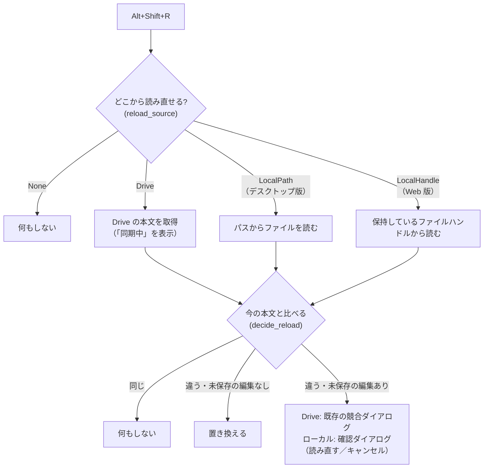

# シートの再読み込み（Alt+Shift+R）と Alt+R のバッジ表示 仕様

- 対象バージョン: v0.30.5 以降
- 関連仕様: `docs/PROJECT_SHEET_ON_DEMAND_SPEC.md`
- 状態: **実装済み（2026-09-17）**。テスト 8 件は緑。実機での動作確認待ち（§5）

## 1. Alt+Shift+R: アクティブなシートを読み直す

### 1-1. 目的

開いているシートが別の場所で更新された時、タブを閉じずにその場で最新の内容へ更新する。
Google ドライブのシートと、ローカルファイルのシートの両方が対象。

### 1-2. 動作



| 状態 | どこから | 動作 |
|---|---|---|
| ターミナルがアクティブ | — | 何もしない |
| 未保存の新規シート（`drive_id` 無し、ローカルでもない） | — | 何もしない |
| Drive のシート | Drive | 本文を比べて置き換え／競合ダイアログ／何もしない |
| ローカルファイル、パスあり（デスクトップ版で開いたもの） | パス | 本文を比べて置き換え／確認ダイアログ／何もしない |
| ローカルファイル、Web 版でハンドルのファイル名がタイトルと一致 | ファイルハンドル | 同上 |
| ローカルファイル、パスもハンドルも無い | — | 何もしない |

- 「何もしない」ケースでは通知を出さない（表示を更新する必要が無いため。レビューで決定）
- キー判定は既存の Alt+R と同じ `code == "KeyR"` を使い、**Shift の有無で分ける**
- Alt+R（Shift なし）の挙動は変えない。Alt+R のダイアログ表示中は無効

**制約**

- **デスクトップ版**: パス（`Sheet.local_path`）はメモリ上だけの値で IndexedDB に保存していない。
  **アプリを再起動して復元されたローカルシートはパスが無いため読み直せない**（開き直せば読み直せる）
- **Web 版**: ブラウザが持つファイルハンドルは**最後に開いた（または保存した）ローカルファイルの 1 つだけ**。
  それ以外のローカルシートは読み直せない。ハンドルの読み取り権限が切れていれば、ブラウザが許可を求める

**経緯**: v0.31.0 の時点では、私（Claude）の判断でローカルファイルを対象外にしていた。
レビューで確認していなかったため、v0.31.1 の後に対応した（2026-10-13）。

### 1-3. 判定の純粋関数（`src/sheet_reload.rs`）

```rust
pub struct ReloadTarget<'a> {
    pub terminal_active: bool,
    pub drive_id: Option<&'a str>,
    pub category: &'a str,              // `__LOCAL__` はローカルファイル
    pub local_path: Option<&'a str>,    // デスクトップ版で開いたローカルファイルのパス
    pub title: &'a str,                 // ローカルファイルではファイル名
    pub web_handle_name: Option<&'a str>, // Web 版で保持しているハンドルのファイル名
}

pub enum ReloadSource { None, Drive, LocalPath, LocalHandle }

pub fn reload_source(target: &ReloadTarget) -> ReloadSource;
```

| # | 規則 |
|---|---|
| 1 | ターミナルがアクティブなら None |
| 2 | ローカルファイル（カテゴリ `__LOCAL__` かパスあり）でパスがあれば LocalPath |
| 3 | ローカルファイルで、Web 版のハンドルのファイル名がタイトルと一致すれば LocalHandle |
| 4 | ローカルファイルで、どちらも無ければ None。`drive_id` があっても Drive からは読まない |
| 5 | ローカルファイルでなく `drive_id` があれば Drive |
| 6 | それ以外（未保存の新規シート）は None |

テスト: `drive_sheet_reloads_from_drive` / `terminal_active_cannot_reload` /
`unsaved_sheet_without_drive_id_cannot_reload` / `local_file_with_path_reloads_from_path` /
`local_file_reloads_from_matching_web_handle` / `local_file_with_other_web_handle_cannot_reload` /
`local_file_without_path_or_handle_cannot_reload` / `local_file_never_reloads_from_drive`

実装:
- デスクトップ版の読み込みは Tauri コマンド `read_local_file_native(path)`（`open_local_file_native` と同じ文字コード処理）
- Web 版の読み込みと両者の振り分けは JS の `reload_local_file(path)`、ハンドル名は `local_handle_name()`
- Rust 側の本体は `reload_local_sheet`、置き換えは `apply_reloaded_local`、確認ダイアログは `pending_local_reload`
- 確認ダイアログの文言は i18n キー `reload_local_title` / `reload_local_message` / `opt_reload_from_file`（9 言語）

### 1-4. 判定の変更（v0.31.0 の不具合修正）

v0.31.0 では既存の同期チェック（`trigger_conflict_check`）を流用していたが、これは
バックグラウンド用の推測で判定するため、手動の再読み込みでは取りこぼしが出た。

- Drive のファイルサイズが前回同期時と同じなら「名前変更などのメタデータ変更」とみなして読み込まない
  → 1 文字の書き換えなど、**バイト数が変わらない編集が反映されない**
- 更新時刻の比較（Drive の時刻 > 最終同期 + 1 秒）にも依存する

手動の再読み込みは専用の `reload_sheet_from_drive`（`src/app.rs`）で行い、**Drive の本文を実際に取得して
今の本文（エディタの内容）と比べる**。判定は `sheet_reload::decide_reload`。

| # | 規則 |
|---|---|
| 1 | 本文が同じなら NoChange（同期時刻だけ追従する） |
| 2 | 違っていて、未保存の編集が無ければ Replace（「同期中」を出して置き換える） |
| 3 | 違っていて、未保存の編集があれば Conflict（既存の競合ダイアログ） |

未保存の編集の有無は `is_modified` / `temp_timestamp` / エディタの内容とシートの内容の差で判定する。
テスト: `same_content_needs_no_change` / `different_content_without_local_edit_is_replaced` /
`same_size_edit_is_still_detected` / `different_content_with_local_edit_goes_to_conflict`

## 2. Alt+R ダイアログのバッジ表示

### 2-1. 目的

未オープンのシートをタイトル文字のグレーだけで区別するのは分かりづらいため、
カードの右下のバッジで状態を示す。

### 2-2. 表示規則

| カードの状態 | バッジ | 色 | 大きさ |
|---|---|---|---|
| **編集中**（今アクティブなシート／ターミナル） | 「編集中」 | **オレンジ**（`bg-orange-500`） | 現行より一回り大きい |
| **表示中**（タブで開いているが、アクティブではない） | 「表示中」 | **緑**（`bg-emerald-600`、現行のまま） | 「編集中」と同じ（現行より一回り大きい） |
| 未オープン（タブになっていない所属シート） | なし | — | — |

- 未オープンのタイトル文字のグレー表示は**廃止**する（バッジの有無で判別できるため）
- ターミナルのカードもシートと同じ規則（アクティブなターミナルは「編集中」、他は「表示中」）
- 「編集中」の文言は新しい i18n キー `editing_sheet`（9 言語）。「表示中」は既存の `active_sheet` を使う
- 大きさ: 両方ともデスクトップ `text-xs`・Web `text-[10px]`、余白 `px-1.5 py-1`（現行の `badge_text_class`・`px-1 py-0.5` より一回り大きい）

### 2-3. 判定の純粋関数（`src/components/project_sheet_switcher.rs`）

```rust
pub enum SwitcherBadge { Editing, Open }

impl SwitcherItem {
    /// カードに出すバッジ。未オープンは None
    pub fn badge(&self, is_active: bool) -> Option<SwitcherBadge>;
}
```

| # | 規則 |
|---|---|
| 1 | `ClosedSheet` は常に None |
| 2 | `OpenSheet` / `Terminal` でアクティブなら `Editing` |
| 3 | `OpenSheet` / `Terminal` でアクティブでなければ `Open` |

## 3. テスト（先行して作成）

`src/sheet_reload.rs`:

| # | テスト名 | 規則 |
|---|---|---|
| 1 | `drive_sheet_can_be_reloaded` | 1-3 #4 |
| 2 | `terminal_active_cannot_reload` | 1-3 #1 |
| 3 | `unsaved_sheet_without_drive_id_cannot_reload` | 1-3 #2 |
| 4 | `local_file_sheet_cannot_reload` | 1-3 #3 |

`src/components/project_sheet_switcher.rs`:

| # | テスト名 | 規則 |
|---|---|---|
| 5 | `closed_sheet_has_no_badge` | 2-3 #1 |
| 6 | `active_open_sheet_shows_editing_badge` | 2-3 #2 |
| 7 | `inactive_open_sheet_shows_open_badge` | 2-3 #3 |
| 8 | `terminals_follow_the_same_badge_rule` | 2-3 #2, #3 |

## 4. 影響範囲

| ファイル | 変更 |
|---|---|
| `src/sheet_reload.rs`（新規）、`src/main.rs` | 判定の純粋関数とテスト、モジュール登録 |
| `src/app.rs` | キーハンドラに Alt+Shift+R を追加（`trigger_conflict_check` をアクティブなシートに対して呼ぶ）。Alt+R の判定に「Shift なし」を追加 |
| `src/components/project_sheet_switcher.rs` | `SwitcherBadge` / `badge()`。カード右下のバッジを状態で出し分け |
| `src/i18n.rs` | `editing_sheet`（9 言語） |
| `src/components/shortcut_help.rs` | Alt+H のヘルプに Alt+P / Alt+R / Alt+Shift+R / Alt+Shift+T とプレビュー中のスクロール操作を追加。Alt+T の説明を実際の挙動（表示・切り替え。無ければ起動）に修正 |

## 5. 動作確認項目（実装後）

- [ ] 別の端末で更新したシートを開いたまま Alt+Shift+R → 「同期中」が出て内容が置き換わる
- [ ] 未保存の編集がある状態で Alt+Shift+R → 競合ダイアログが出る
- [ ] Drive が新しくない時の Alt+Shift+R → 何も起きない（内容が消えたりしない）
- [ ] ターミナル / 未保存の新規シートで Alt+Shift+R → 何も起きない
- [ ] （デスクトップ版）開いたローカルファイルを外部のエディタで書き換えて Alt+Shift+R → 置き換わる
- [ ] （デスクトップ版）未保存の編集がある状態で Alt+Shift+R → 確認ダイアログ。「読み直す」で置き換わり、「キャンセル」で何も変わらない
- [ ] （Web 版）最後に開いたローカルファイルで同様に置き換わる。別のローカルシートでは何も起きない
- [ ] Alt+R（Shift なし）は従来どおりダイアログが開閉する
- [ ] Alt+R のカード: アクティブは大きめのオレンジ「編集中」、他の開いているタブは同じ大きさの緑「表示中」、未オープンはバッジ無し（タイトルのグレー表示は無くなっている）
- [ ] ターミナルのカードも同じ規則
- [ ] 9 言語で「編集中」が翻訳されている
