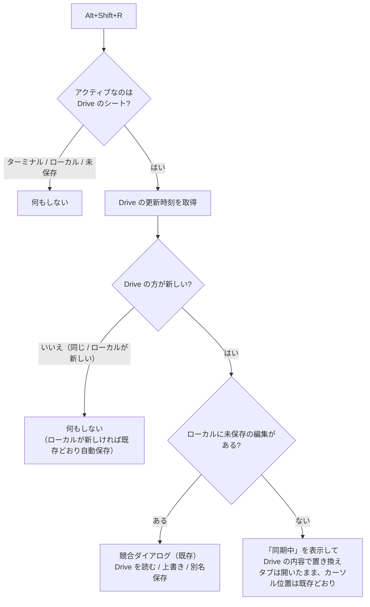

# シートの再読み込み（Alt+Shift+R）と Alt+R のバッジ表示 仕様

- 対象バージョン: v0.30.5 以降
- 関連仕様: `docs/PROJECT_SHEET_ON_DEMAND_SPEC.md`
- 状態: **実装済み（2026-09-17）**。テスト 8 件は緑。実機での動作確認待ち（§5）

## 1. Alt+Shift+R: アクティブなシートを Drive から再読み込み

### 1-1. 目的

開いているシートが別の端末やブラウザで更新された時、タブを閉じずにその場で
最新の内容へ更新できるようにする。

### 1-2. 動作

既存の同期チェック（`trigger_conflict_check`）を、アクティブなシートに対して手動で走らせる。
起動時・オンライン復帰時・タブ復帰時と同じ判定なので、挙動は既存と揃う。



| 状態 | 動作 |
|---|---|
| ターミナルがアクティブ | 何もしない |
| ローカルファイルのシート（`__LOCAL__`） | 何もしない（Drive に無い） |
| 未保存の新規シート（`drive_id` 無し） | 何もしない |
| Drive のシート、Drive の方が新しい、未保存の編集なし | **「同期中」を出して置き換える** |
| Drive のシート、Drive の方が新しい、未保存の編集あり | **既存の競合ダイアログ** |
| Drive のシート、Drive が新しくない | 何もしない（見た目の変化なし） |

- 「何もしない」ケースでは通知を出さない（既存の自動同期と同じ。必要なら後で追加する）
- キー判定は既存の Alt+R と同じ `code == "KeyR"` を使い、**Shift の有無で分ける**。
  macOS で Option+Shift+R が `‰` 等の文字を出しても `code` で拾える
- Alt+R（Shift なし）の挙動は変えない
- プレビュー表示中でも有効（Alt+R と同じ扱い）。Alt+R のダイアログ表示中は無効

### 1-3. 判定の純粋関数（`src/sheet_reload.rs`、新規）

```rust
pub struct ReloadTarget<'a> {
    /// ターミナルがアクティブか
    pub terminal_active: bool,
    /// アクティブなシートの Drive ID
    pub drive_id: Option<&'a str>,
    /// アクティブなシートのカテゴリ（`__LOCAL__` はローカルファイル）
    pub category: &'a str,
}

/// Drive から再読み込みできるシートか
pub fn can_reload_from_drive(target: &ReloadTarget) -> bool;
```

| # | 規則 |
|---|---|
| 1 | ターミナルがアクティブなら false |
| 2 | `drive_id` が無ければ false（未保存の新規シート） |
| 3 | カテゴリが `__LOCAL__` なら false（ローカルファイル） |
| 4 | それ以外（Drive のシート）は true |

### 1-4. 判定の変更（v0.31.0 の不具合修正）

v0.31.0 では既存の同期チェック（`trigger_conflict_check`）を流用していたが、これは
バックグラウンド用の推測で判定するため、手動の再読み込みでは取りこぼしが出た。

- Drive のファイルサイズが前回同期時と同じなら「名前変更などのメタデータ変更」とみなして読み込まない
  → 1 文字の書き換えなど、**バイト数が変わらない編集が反映されない**
- 更新時刻の比較（Drive の時刻 > 最終同期 + 1 秒）にも依存する

手動の再読み込みは専用の `reload_sheet_from_drive`（`src/app.rs`）で行い、**Drive の本文を実際に取得して
今の本文（エディタの内容）と比べる**。判定は `sheet_reload::decide_reload`。

| # | 規則 |
|---|---|
| 1 | 本文が同じなら NoChange（同期時刻だけ追従する） |
| 2 | 違っていて、未保存の編集が無ければ Replace（「同期中」を出して置き換える） |
| 3 | 違っていて、未保存の編集があれば Conflict（既存の競合ダイアログ） |

未保存の編集の有無は `is_modified` / `temp_timestamp` / エディタの内容とシートの内容の差で判定する。
テスト: `same_content_needs_no_change` / `different_content_without_local_edit_is_replaced` /
`same_size_edit_is_still_detected` / `different_content_with_local_edit_goes_to_conflict`

## 2. Alt+R ダイアログのバッジ表示

### 2-1. 目的

未オープンのシートをタイトル文字のグレーだけで区別するのは分かりづらいため、
カードの右下のバッジで状態を示す。

### 2-2. 表示規則

| カードの状態 | バッジ | 色 | 大きさ |
|---|---|---|---|
| **編集中**（今アクティブなシート／ターミナル） | 「編集中」 | **オレンジ**（`bg-orange-500`） | 現行より一回り大きい |
| **表示中**（タブで開いているが、アクティブではない） | 「表示中」 | **緑**（`bg-emerald-600`、現行のまま） | 「編集中」と同じ（現行より一回り大きい） |
| 未オープン（タブになっていない所属シート） | なし | — | — |

- 未オープンのタイトル文字のグレー表示は**廃止**する（バッジの有無で判別できるため）
- ターミナルのカードもシートと同じ規則（アクティブなターミナルは「編集中」、他は「表示中」）
- 「編集中」の文言は新しい i18n キー `editing_sheet`（9 言語）。「表示中」は既存の `active_sheet` を使う
- 大きさ: 両方ともデスクトップ `text-xs`・Web `text-[10px]`、余白 `px-1.5 py-1`（現行の `badge_text_class`・`px-1 py-0.5` より一回り大きい）

### 2-3. 判定の純粋関数（`src/components/project_sheet_switcher.rs`）

```rust
pub enum SwitcherBadge { Editing, Open }

impl SwitcherItem {
    /// カードに出すバッジ。未オープンは None
    pub fn badge(&self, is_active: bool) -> Option<SwitcherBadge>;
}
```

| # | 規則 |
|---|---|
| 1 | `ClosedSheet` は常に None |
| 2 | `OpenSheet` / `Terminal` でアクティブなら `Editing` |
| 3 | `OpenSheet` / `Terminal` でアクティブでなければ `Open` |

## 3. テスト（先行して作成）

`src/sheet_reload.rs`:

| # | テスト名 | 規則 |
|---|---|---|
| 1 | `drive_sheet_can_be_reloaded` | 1-3 #4 |
| 2 | `terminal_active_cannot_reload` | 1-3 #1 |
| 3 | `unsaved_sheet_without_drive_id_cannot_reload` | 1-3 #2 |
| 4 | `local_file_sheet_cannot_reload` | 1-3 #3 |

`src/components/project_sheet_switcher.rs`:

| # | テスト名 | 規則 |
|---|---|---|
| 5 | `closed_sheet_has_no_badge` | 2-3 #1 |
| 6 | `active_open_sheet_shows_editing_badge` | 2-3 #2 |
| 7 | `inactive_open_sheet_shows_open_badge` | 2-3 #3 |
| 8 | `terminals_follow_the_same_badge_rule` | 2-3 #2, #3 |

## 4. 影響範囲

| ファイル | 変更 |
|---|---|
| `src/sheet_reload.rs`（新規）、`src/main.rs` | 判定の純粋関数とテスト、モジュール登録 |
| `src/app.rs` | キーハンドラに Alt+Shift+R を追加（`trigger_conflict_check` をアクティブなシートに対して呼ぶ）。Alt+R の判定に「Shift なし」を追加 |
| `src/components/project_sheet_switcher.rs` | `SwitcherBadge` / `badge()`。カード右下のバッジを状態で出し分け |
| `src/i18n.rs` | `editing_sheet`（9 言語） |
| `src/components/shortcut_help.rs` | Alt+H のヘルプに Alt+P / Alt+R / Alt+Shift+R / Alt+Shift+T とプレビュー中のスクロール操作を追加。Alt+T の説明を実際の挙動（表示・切り替え。無ければ起動）に修正 |

## 5. 動作確認項目（実装後）

- [ ] 別の端末で更新したシートを開いたまま Alt+Shift+R → 「同期中」が出て内容が置き換わる
- [ ] 未保存の編集がある状態で Alt+Shift+R → 競合ダイアログが出る
- [ ] Drive が新しくない時の Alt+Shift+R → 何も起きない（内容が消えたりしない）
- [ ] ターミナル / ローカルファイル / 未保存の新規シートで Alt+Shift+R → 何も起きない
- [ ] Alt+R（Shift なし）は従来どおりダイアログが開閉する
- [ ] Alt+R のカード: アクティブは大きめのオレンジ「編集中」、他の開いているタブは同じ大きさの緑「表示中」、未オープンはバッジ無し（タイトルのグレー表示は無くなっている）
- [ ] ターミナルのカードも同じ規則
- [ ] 9 言語で「編集中」が翻訳されている
