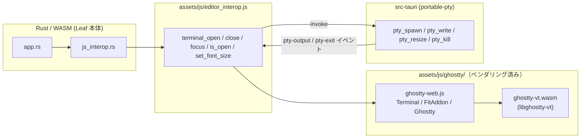
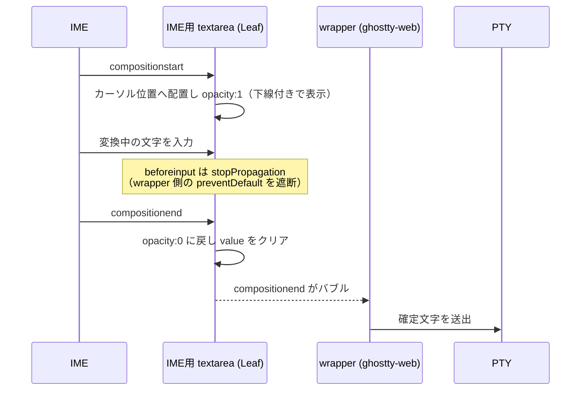
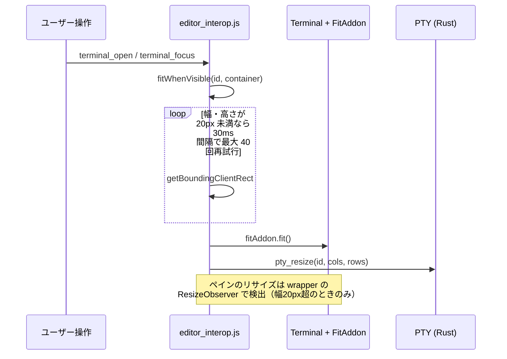

# ターミナル描画エンジン置き換え仕様（xterm.js → ghostty-web）

- 対象バージョン: v0.29.3 以降（ブランチ `feature/wterm-renderer`）
- 対象: デスクトップ版（Tauri）のターミナルタブのみ。Web 版は PTY を持たないため対象外。

## 1. 背景と目的

従来のターミナルは xterm.js を jsDelivr の CDN から実行時に読み込んでいた。

| 課題 | 内容 |
|---|---|
| 外部依存 | 起動のたびに `cdn.jsdelivr.net` から CSS/JS を取得。オフラインや CDN 障害で無効化 |
| VT 互換性 | 手書き JavaScript の VT 実装。複雑なシーケンスの解釈に限界がある |
| CJK 行高 | 欧文フォント基準で行高を算出するため日本語の上下が切れる（`lineHeight: 1.2` で暫定回避） |

[ghostty-web](https://github.com/coder/ghostty-web)（MIT）は、ターミナルエミュレータ
**Ghostty 本体と同じ VT エンジン `libghostty-vt`** を WASM 化したもの。
xterm.js 互換 API を持つため、既存コードの構造をほぼ維持したまま差し替えられる。

## 2. 検討の経緯（wterm を採用しなかった理由）

当初は [wterm](https://github.com/vercel-labs/wterm)（Zig→WASM コア + DOM 描画、WASM 約 24KB）で
実装したが、実機検証で以下の不具合が出たため不採用とした。

| 症状 | 影響 |
|---|---|
| tmux 上で画面全体が黄色く描画される | SGR（文字色・背景色）の解釈が破綻。TUI が実用にならない |
| 日本語が入力できない | IME（composition）の取り込みに問題 |

DOM 描画によるネイティブな範囲選択という利点はあったが、
**VT 互換性と日本語入力という基本機能を満たせないため見送った。**
ghostty-web は canvas 描画のため OS ネイティブの範囲選択は使えないが、
独自の SelectionManager（`getSelection` / `selectAll` など xterm.js 互換 API）を備える。

| | xterm.js（従来） | wterm（不採用） | ghostty-web（採用） |
|---|---|---|---|
| VT 実装 | 手書き JS | 独自 Zig 実装 | **libghostty-vt（Ghostty 本体と同一）** |
| 描画 | canvas | DOM | canvas |
| WASM サイズ | — | 約 24KB | 約 413KB |
| API | — | 独自 | **xterm.js 互換** |
| 配信 | CDN | 同梱 | 同梱 |
| tmux | 可 | **不可（色崩れ）** | 可 |
| 日本語入力 | 可 | **不可** | 可（Leaf 側で IME 補完） |

## 3. アーキテクチャ



Rust 側（`js_interop.rs`、`pty_*` コマンド、`terminal-exit` イベント）は**一切変更しない**。
JS の公開関数シグネチャを維持したまま、内部の描画エンジンだけを差し替える。

## 4. ベンダリング

Leaf は JS バンドラを使わず `assets/` をそのまま配信するため、npm パッケージを
実行時に解決できない。`scripts/vendor-ghostty.mjs` が以下を行う。

1. `node_modules/ghostty-web/dist/*.js` を `assets/js/ghostty/` へコピー
2. `sourceMappingURL` コメントを除去（`.map` は配信しないため 404 警告を防ぐ）
3. `ghostty-vt.wasm` と `LICENSE`、`VERSION` を出力

生成物はリポジトリにコミットするため、ビルド時に npm パッケージは不要。
更新時は `npm run vendor:ghostty` を実行する。

### WASM の読み込み

`Ghostty.load()` は引数を省略すると、`ghostty-web.js` 内に埋め込まれた
約 550KB の `data:application/wasm;base64,...` を経由する。
起動時の復号コストを避けるため、`.wasm` を別ファイルで配置して
**明示的な URL を渡す**。

```js
_ghostty = await mod.Ghostty.load(ghosttyAsset('assets/js/ghostty/ghostty-vt.wasm'));
```

WASM インスタンスは全ターミナルタブで共有し、`new Terminal({ ghostty: _ghostty })` で渡す。

## 5. 実装対応表

| 項目 | xterm.js | ghostty-web |
|---|---|---|
| 読み込み | CDN `<script>` | `import()`（`document.baseURI` 基準で解決） |
| 生成 | `new window.Terminal(opts)` | `new Terminal({ ...opts, ghostty })` |
| フィット | `new window.FitAddon.FitAddon()` | `new FitAddon()`（同梱） |
| テーマ | `theme` オブジェクト | 同じ（`ITheme` 互換） |
| フォントサイズ | `terminal.options.fontSize` | 同じ |
| 行高 | `lineHeight: 1.2` を明示 | オプションなし（Ghostty のフォントメトリクスに委譲） |
| 破棄 | `terminal.dispose()` | 同じ（addon も内部で破棄されるため個別 dispose 不要） |

`allowProposedApi` と `lineHeight` は ghostty-web に存在しないため削除した。

## 6. IME（日本語入力）対応

ghostty-web は日本語入力に以下の不足があり、Leaf 側で補っている
（`setupIme()`。ベンダリングした ghostty-web 自体には手を入れていない）。

| ghostty-web の実装 | 結果 |
|---|---|
| `terminal.focus()` が `canvas.parentElement`（`contenteditable` の wrapper）をフォーカス | 変換が contenteditable 上で行われる |
| `handleCompositionUpdate` が空実装 | 変換中の文字がどこにも描画されない |
| 入力用の hidden textarea が端末左上（`left:0; top:0`）に固定 | 変換候補ウィンドウがカーソル位置に出ない |

### 対処

IME 専用の `<textarea>` をカーソル位置に置き、そこをフォーカス対象にする。



- 変換中のみ `opacity:1` にし、端末と同じフォント・配色・下線でその場に描画する
- `keydown` / `compositionend` / `paste` は wrapper へバブルするため、ghostty-web の
  キーエンコード・確定文字送出・ペースト処理はそのまま働く
- ghostty-web は wrapper の `beforeinput` を `preventDefault` しているため、
  そのままだと IME 用 textarea への文字挿入まで止まる。`stopPropagation` で遮断する
- canvas クリック時に ghostty-web が自前の textarea へフォーカスを移すので `focusin` で
  引き戻す。ただし ghostty-web はクリップボードのフォールバック処理でも自前 textarea を
  一時利用する（`value` に本文を入れる）ため、その間は割り込まない
- セルサイズは canvas の実表示サイズ ÷ `cols`/`rows`、カーソル位置は xterm.js 互換の
  `terminal.buffer.active.cursorX / cursorY` から求める

## 7. Cmd 修飾キーの扱い

`handleKeyDown` の最終分岐は、修飾キー付きのキーを一律 `preventDefault()` +
`stopPropagation()` する。このため **Cmd+Q でアプリが終了しなくなる**。

wrapper のキャプチャ段で Cmd 修飾のキーを `stopPropagation()` し、ターミナルへ
渡さないようにする（`blockAppShortcuts()`）。

- Cmd+C / Cmd+V は ghostty-web 側が元々素通ししてネイティブのコピー＆ペーストに
  任せているため、ここでも通す
- Leaf 本体のキーハンドラは `window` の**キャプチャ段**に登録されている
  （`src/app.rs`）ため wrapper より先に走る。Alt+O などの既存ショートカットには影響しない

## 8. サイズ同期フロー



タブ切り替え直後はコンテナが非表示（幅 0）のことがあるため、
表示されるまで再試行してから PTY へサイズを通知する。

## 9. 影響範囲

| ファイル | 変更内容 |
|---|---|
| `assets/js/editor_interop.js` | ターミナル節を全面置換（公開関数のシグネチャは維持） |
| `assets/js/ghostty/**` | 新規。ベンダリングされた ghostty-web + WASM |
| `scripts/vendor-ghostty.mjs` | 新規。ベンダリングスクリプト |
| `package.json` | `ghostty-web` 依存と `vendor:ghostty` スクリプトを追加 |

Rust ソース・`index.html`・`sw.js` は変更なし。

## 10. 動作確認項目

macOS (Apple Silicon) で確認済み:

- [x] ターミナルタブを開くとシェルが起動する（スピナーが消える）
- [x] **tmux が正しく描画される**（色崩れがない）← wterm で失敗した項目
- [x] **日本語を IME でインライン入力できる** ← wterm で失敗した項目
- [x] **Cmd+Q でアプリが終了する**

未確認（要検証）:

- [ ] Windows / Linux での日本語 IME 入力
- [ ] 日本語の出力が上下に切れない
- [ ] vim など TUI が正しく描画される
- [ ] マウスでの範囲選択とコピー（Cmd+C / Cmd+V）
- [ ] ペイン分割・ウィンドウリサイズで cols/rows が追随する
- [ ] フォントサイズ変更が反映される
- [ ] 複数ターミナルタブの切り替えで表示が壊れない
- [ ] `exit` でタブが自動的に閉じる
- [ ] オフラインでもターミナルが起動する（CDN 依存の解消確認）
