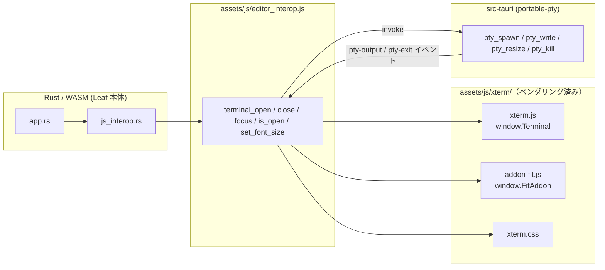

# ターミナル描画エンジン仕様（xterm.js ベンダリング）

- 対象: デスクトップ版（Tauri）のターミナルタブのみ。Web 版は PTY を持たないため対象外。
- 現行: **xterm.js（`assets/js/xterm/` へベンダリング）**

## 1. 現状

ターミナルの描画は xterm.js を使う。以前は jsDelivr の CDN から実行時に
読み込んでいたが、オフラインや CDN 障害でターミナルが使えなくなるため、
**同梱配信へ切り替えた**。読み込み方以外の実装は従来どおり。

## 2. ベンダリング

Leaf は JS バンドラを使わず `assets/` をそのまま配信するため、npm パッケージを
実行時に解決できない。`scripts/vendor-xterm.mjs` が必要なファイルだけを取り込む。

| 取り込むもの | 出力先 |
|---|---|
| `@xterm/xterm/lib/xterm.js` | `assets/js/xterm/xterm.js` |
| `@xterm/xterm/css/xterm.css` | `assets/js/xterm/xterm.css` |
| `@xterm/addon-fit/lib/addon-fit.js` | `assets/js/xterm/addon-fit.js` |
| `@xterm/xterm/LICENSE`、`VERSION` | 同上 |

UMD ビルドなので `<script>` で読み込めば従来どおり `window.Terminal` /
`window.FitAddon` が生える。生成物はリポジトリにコミットするため、
ビルド時に npm パッケージは不要。更新時は `npm run vendor:xterm` を実行する。

パスは wasm-bindgen のスニペットとして配置される事情から、`document.baseURI`
基準で解決する（`xtermAsset()`）。

## 3. CJK の行高

xterm.js は行の高さをフォントリスト先頭の欧文フォントのメトリクスから算出する。
CJK フォントは ascent/descent が大きく既定の `lineHeight: 1.0` では収まらず、
日本語などの上下が切れるため `lineHeight: 1.2` を明示する。

フォントは `'JetBrains Mono', 'Menlo', 'Monaco', 'Noto Sans Mono CJK JP',
'Noto Sans CJK JP', 'Courier New', monospace` を指定する。

## 4. 検討の経緯（他エンジンを採用しなかった理由）

描画方式の改善を狙って 2 つの代替を試したが、いずれも**日本語入力で実用に
ならず差し戻した**。同じ検討を繰り返さないため経緯を残す。

### 4-1. wterm（vercel-labs、Zig→WASM + DOM 描画、WASM 約 24KB）

| 症状 | 影響 |
|---|---|
| tmux 上で画面全体が黄色く描画される | SGR（文字色・背景色）の解釈が破綻。TUI が実用にならない |
| 日本語が入力できない | IME（composition）の取り込みに問題 |

DOM 描画によるネイティブな範囲選択という利点はあったが、
VT 互換性と日本語入力という基本機能を満たせず見送った。

### 4-2. ghostty-web（coder、libghostty-vt を WASM 化、canvas 描画、WASM 約 413KB）

tmux の描画は正しく、VT 互換性は本家品質だったが、以下が解決できなかった。

| 症状 | 原因 |
|---|---|
| 日本語のインライン入力が出ない | `handleCompositionUpdate` が空実装。変換中の文字を描画する処理が無い |
| 変換候補ウィンドウが端末の左上に出る | 入力用の hidden textarea が `left:0; top:0` に固定 |
| 他アプリから戻ると IME が効かなくなる | `terminal.focus()` が `contenteditable` の wrapper をフォーカスするため |
| Cmd+Q でアプリが終了しない | `handleKeyDown` が修飾キー付きのキーを一律 `preventDefault` |
| **Windows でテキストの見栄えが悪い** | canvas 描画のフォントメトリクス由来 |
| **IME インライン入力時に文字の上部が欠ける** | 同上 |

IME 用の textarea を Leaf 側で用意して前 4 件は回避できたが、
Windows での描画品質（下 2 件）は canvas 描画に起因し、
Leaf 側で詰められる問題ではないため差し戻した。

xterm.js は `CompositionHelper` を内蔵していて IME のインライン表示を
自前で持ち、meta 修飾キーも素通しする。**日本語環境ではこれらが決定的**。

### 4-3. まとめ

| | xterm.js（現行） | wterm | ghostty-web |
|---|---|---|---|
| VT 実装 | 手書き JS | 独自 Zig 実装 | libghostty-vt |
| 描画 | DOM | DOM | canvas |
| tmux | 可 | **不可（色崩れ）** | 可 |
| 日本語 IME | **標準で可** | **不可** | 要自前実装・Windows で欠け |
| Cmd+Q | 可 | — | 要回避策 |
| 配信 | 同梱 | 同梱 | 同梱 |

**エンジンを替える動機だった「CDN 依存の解消」は、xterm.js を
そのままベンダリングすれば達成できた。** 描画エンジンごと差し替える必要は
無かった、というのが結論。

## 5. 影響範囲

| ファイル | 内容 |
|---|---|
| `assets/js/editor_interop.js` | ターミナルの実装（公開関数のシグネチャは不変） |
| `assets/js/xterm/**` | ベンダリングされた xterm.js |
| `scripts/vendor-xterm.mjs` | ベンダリングスクリプト |
| `package.json` | `@xterm/xterm` / `@xterm/addon-fit` 依存と `vendor:xterm` |

Rust 側（`js_interop.rs`、`pty_*` コマンド、`terminal-exit` イベント）は不変。

## 6. 動作確認項目

- [ ] ターミナルタブを開くとシェルが起動する（スピナーが消える）
- [ ] tmux / vim など TUI が正しく描画される
- [ ] 日本語を IME でインライン入力できる（macOS / Windows）
- [ ] 日本語の出力が上下に切れない
- [ ] Cmd+Q でアプリが終了する
- [ ] マウスでの範囲選択とコピー
- [ ] ペイン分割・ウィンドウリサイズで cols/rows が追随する
- [ ] フォントサイズ変更が反映される
- [ ] 複数ターミナルタブの切り替えで表示が壊れない
- [ ] `exit` でタブが自動的に閉じる
- [ ] オフラインでもターミナルが起動する（CDN 依存の解消確認）
